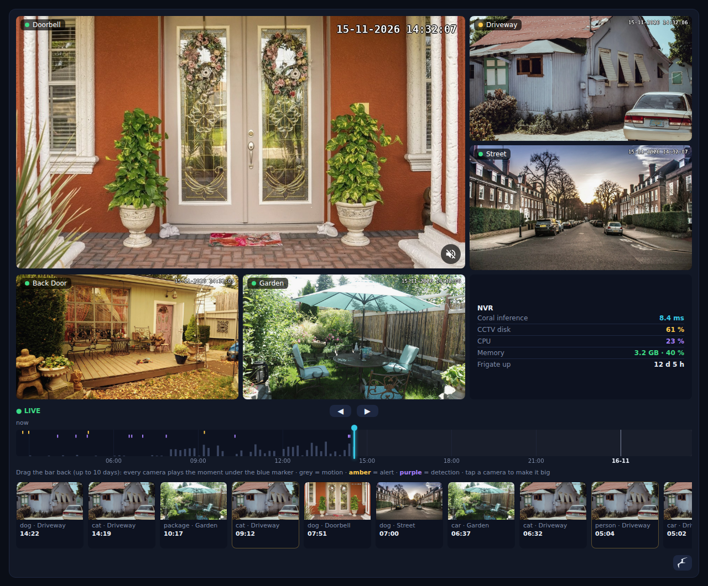

# CCTV card for Home Assistant + Frigate

One card for a CCTV dashboard tab, laid out for both desktop and phone. It shows a live grid of your
cameras with **one timeline for all of them**. Drag the timeline back and **every camera replays the
same moment** from its Frigate recording.

| Desktop | Phone |
|---|---|
|  |  |

*(Mock-up: the real card with stock photos in place of the cameras, and made-up events. Photo credits at the bottom.)*

## What it does

- **Live grid.** One big camera with the rest small. Tap a small camera to make it the big one.
- **One timeline.** It covers 24 hours with the blue marker fixed in the middle.
  - grey = motion
  - amber = Frigate alert
  - purple = Frigate detection
  - the shaded right half is the future
- **Replay.** Drag the bar (or use the mouse wheel on desktop) back up to 10 days. Every tile plays its
  recording from the moment under the marker, and playback carries on until you press **Back to live**.
  Tapping the bar jumps straight to that time.
- **◀ ▶** (optional) step through **alerts**, newest first. ▶ past the newest alert returns to live.
- **Events strip** under the timeline: Frigate review thumbnails. Tap one to replay all cameras at that moment.
- **Occupancy dot** on each camera label: green normally, amber while something is detected.
- **NVR panel** (optional, desktop): Coral inference speed, disk, CPU, memory, uptime.
- **Sound button** (optional, per camera), e.g. for a doorbell. Cameras start muted and the button
  turns sound on for that tile. Leaving the page mutes it again.
- **Frigate button** (optional) bottom right, opens your Frigate UI in a new tab.
- **Light and dark**: follows each user's Home Assistant theme.

## What you need

- **[Frigate](https://frigate.video)** with recording on (continuous recording if you want to replay
  any moment, not just events).
- **[Frigate integration](https://github.com/blakeblackshear/frigate-hass-integration)** for Home Assistant.
  The card reads reviews, recordings and thumbnails through it.
- **[Advanced Camera Card](https://github.com/dermotduffy/advanced-camera-card)** 8.x. Each live tile is
  one of its cards.
- A browser that can play your cameras' codec. **H.265 recordings only replay in browsers that decode
  HEVC.**

Tested on Home Assistant 2026.11, Frigate integration 5.15.6, Advanced Camera Card 8.2.0, with five
cameras.

## Install

1. Copy [`cctv-card.js`](cctv-card.js) to `/config/www/cctv-card.js`.
2. **Settings → Dashboards → ⋮ → Resources → Add resource**: URL `/local/cctv-card.js?v=1`, type
   *JavaScript module*. Change the `?v=` number every time you update the file, or browsers keep the old one.
3. Add the cards. [`dashboard-example.yaml`](dashboard-example.yaml) is a whole view with both cards in it.
   [`desktop-example.yaml`](desktop-example.yaml) and [`mobile-example.yaml`](mobile-example.yaml) are the
   two cards on their own.

## Desktop and phone

Use two copies of the card in the same view, each with a screen-width `visibility` condition:

- **Desktop** (`min-width: 768px`): the default grid, 3 columns. The big tile takes 2×2 and the NVR panel
  fills the last cell.
- **Phone** (`max-width: 767px`): `layout: strip` with `columns: 2`. The big tile goes full width and the
  rest sit underneath, two per row, without labels so the picture isn't covered.
  `quality_by_size: true` keeps the small tiles on a lighter stream.

## Options

| Option | Default | What it does |
|---|---|---|
| `cameras` | **required** | List of cameras (below). The first one starts big. |
| `columns` | `3` | Grid columns. |
| `layout` | grid | `strip` = big tile full width, small ones underneath (phone). |
| `nav_buttons` | `false` | Show ◀ ▶ to step through alerts. |
| `events` | `true` | `false` hides the events strip. |
| `event_style` | compact | `detail` = wider event cards with date, duration, camera and zones. |
| `nvr` | none | NVR panel entities (below). Leave out to hide the panel. |
| `quality_by_size` | `false` | Big tile plays the main stream, small tiles each camera's `sub` stream (via go2rtc). |
| `big_first` | `false` | When replaying, load the big tile first and the small ones after it. Feels quicker on a slow connection. |
| `frigate_url` | none | Shows a Frigate button that opens this URL. |
| `instance_id` | `frigate` | Frigate integration instance, if you have more than one. |

**Each camera:**

| Key | What it is |
|---|---|
| `entity` | The camera entity, e.g. `camera.driveway`. |
| `frigate` | The camera name in Frigate, e.g. `Driveway`. Also the go2rtc stream name for `quality_by_size`. |
| `name` | Label on the tile. |
| `occupancy` | Optional. A binary sensor (e.g. Frigate's `binary_sensor.<camera>_all_occupancy`) that turns the label dot amber. |
| `sub` | Optional. go2rtc stream name for the small tile with `quality_by_size`, e.g. `Driveway_sub`. |
| `audio` | Optional. `true` adds the sound button to this camera. |

**`nvr` panel:** `coral` (ms), `disk` (%), `cpu` (%), `mem` (GB), `mem_pct` (%), `uptime` (seconds, e.g.
`sensor.frigate_uptime`). Use whichever sensors you have for the machine Frigate runs on.

## Notes

- **Times are shown in `Europe/Dublin`.** It's set at the top of `cctv-card.js` (`const TZ`). Change it
  to your own time zone.
- Replay loads clips through the Frigate integration's recording proxy, 30 seconds at a time, and
  chains the next one when a clip ends.
- Timeline motion is loaded in 6-hour blocks. Past blocks are cached, and the current block refreshes
  every 5 minutes.
- Every dashboard save or resource change reloads open dashboards. That's Home Assistant, not the card.

## Photo credits

The screenshots use public-domain (CC0) photos, cropped and given a camera clock:
[front door](https://www.rawpixel.com/image/6038157/photo-image-public-domain-trees-wood),
[driveway](https://www.rawpixel.com/image/3290508/free-photo-image-outdoor-house-background-automobile-building) and
[street](https://www.rawpixel.com/image/3301349/free-photo-image-car-city-road-asphalt) from rawpixel;
[back deck](https://www.flickr.com/photos/71401718@N00/11283075513) and
[garden](https://www.flickr.com/photos/71401718@N00/9181680406) by Wonderlane on Flickr.

## License

MIT. Worked through with Claude.
